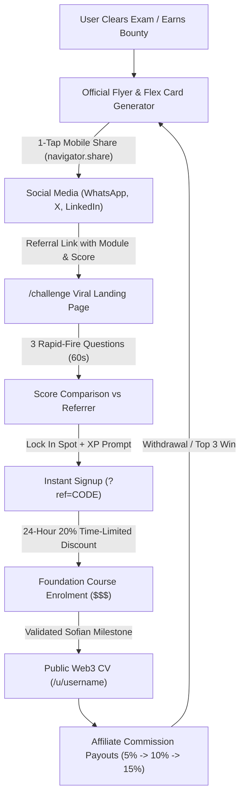
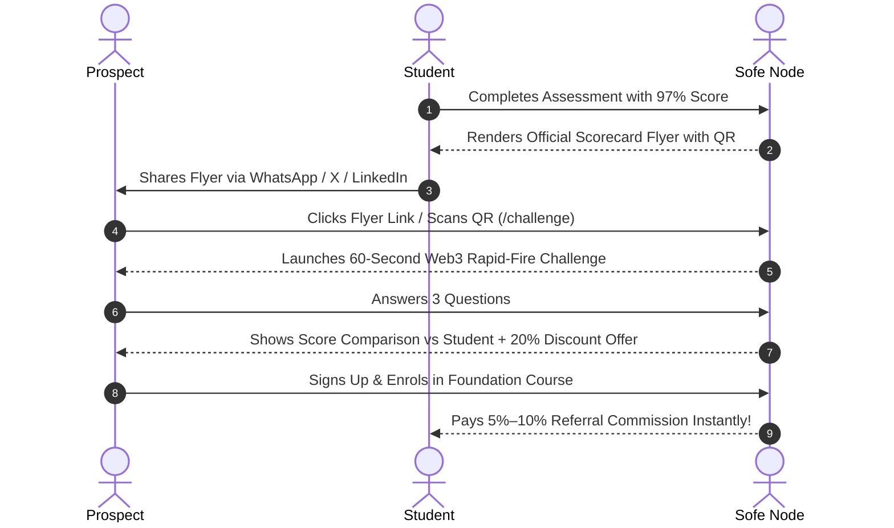

# Sofe Node: Master Feature Release & Sales Conversion Playbook

> **Live Production URLs:**

> - **Main Application:** [https\://node.sofegroup.com](https://node.sofegroup.com) / [https\://sofe-node.web.app](https://sofe-node.web.app)  
> - **Admin Operations Console:** [https\://node.sofegroup.com/admin-dashboard-v2.html](https://node.sofegroup.com/admin-dashboard-v2.html)  
> - **Git Reference:** `feature/nextjs-migration` (`ae835ad`)

---

## 1\. Executive Summary & Live Feature Architecture

This major platform release transforms Sofe Node from an educational LMS into an **autonomous viral growth engine and monetized talent distribution ecosystem**.



&nbsp;

---

## 2\. Comprehensive Deployed Feature Matrix

### A. Sofe AI Tutor (Interactive Course Classroom Companion)

* **Model Engine:** Powered by Meta `muse-spark-1.3` via unified OpenAI-compatible SDK streaming protocol.  
* **Context-Aware Classroom:** The AI tutor ingests the active module, lesson transcript, and code boundaries in real time to answer questions without generic hallucinations.  
* **Pre-Exam Practice Quizzes:** Students can request targeted mock questions before attempting official assessments.  
* **Firestore Session Caching:** Conversation state and progress are persisted seamlessly across page refreshes.  
* **Rich Markdown & Code Rendering:** Syntax highlighting, KaTeX math blocks, and formatted lists are rendered natively.

### B. 4 Organic Viral Growth Loops

1. **Peer-Challenge Landing Page (`/challenge?ref={code}&module={id}&score={score}`):**  
   * Eliminates cold `/signup` drop-offs.  
   * Challenges visitors: *"Ekpegbue scored 97% on Introduction to Blockchain. Think you know Web3 better?"*  
   * Visitors play an interactive 3-question rapid-fire challenge.  
   * Compares their score against the referrer and prompts account creation to claim <!-- gdoc_comment_begin: c1 -->`+50 XP` <!-- gdoc_comment_end: c1 -->and lock in leaderboard standing.  
   * Auto-routes new signups to the **24-Hour 20% Time-Limited Discount** for the Foundation Course.  
2. **Public "Live Web3 CV" Profile (`/u/[username]`):**  
   * Read-only, verifiable portfolio link students put in their Twitter/LinkedIn bios.  
   * Displays verified courses, exam percentages, Lifetime Proof-of-Work XP, monthly ranking, and dynamic multiplier badges (`[1X]`, `[5X]`, `[10X] Top Winner` or `Bounty Winner`).  
   * Persistent sticky CTA footer: *"Build your verified Web3 portfolio on Sofe Node"* linked to that student's referral code.  
3. **Proof-of-Work / Payout Flex Card Generator:**  
   * High-contrast visual flyer generator triggered on:  
     - Monthly leaderboard Top 3 finishes  
     - Verified protocol bounty wins  
     - Affiliate commission withdrawals via Paystack  
   * **Privacy Masking Toggle:** Students can show exact NGN/USD earnings OR toggle to mask numbers and highlight their multiplier badges and referral QR code.  
4. **1-Click "Add to LinkedIn Certifications":**  
   * Course completion certificates feature a direct "Add to LinkedIn" modal pre-populating credential ID, issuing organization (*Sofe Node*), and instant verification URLs (`/verify/[id]`).

### C. Share Flyer & Mobile Web Share API Overhaul

* **Zero Overlap Branding:** Top-left header logo (`Sofe Node • ACADEMY`) uses high-contrast typography and dynamic SVG rendering, eliminating clipping.  
* **Relative Percentile Badge:** Displays status metrics like `"Top 5% of Sofians"` or `"Monthly Rank #2"`, communicating social proof.  
* **Native Mobile Sharing (`navigator.share`):**  
  * On mobile devices, clicking *Share* converts the HTML canvas into an actual PNG `File` object (`scorecard.png`) and opens the device's native share sheet with image \+ caption pre-loaded.  
  * Desktop browsers automatically fall back to standard Web Intent links (X tweet window, WhatsApp web URL).  
* **Viral Hook Caption:** Replaced spammy hashtags with a peer-challenge hook:  
  > *"Just cleared the Introduction to Blockchain assessment on @SofeNode with a 97% score (+5 XP). Pushing for the Top 3 spot on this month's leaderboard. Think you can beat 97%? Test your Web3 IQ here: {challengeUrl}"*

### D. 3-Tier Affiliate Commission Economy

| Tier | Title | Direct Comm. | Indirect Comm. | Qualification Criteria |
| :---- | :---- | :---- | :---- | :---- |
| **Level 1** | **Newbie** | **5%** | — | Default for all registered users (must complete Foundation to withdraw). |
| **Level 2** | **Affiliate** | **10%** | — | Automatic once 10 referrals complete Foundation & enrol in a Career Track, or upon temporal boost. |
| **Level 3** | **Ambassador** | **10%** | **5%** | Node Heads, Campus Ambassadors, and Top 3 Leaderboard Boost upgrades. |

* **30-Day Auto-Boost & Safe Downgrade:**  
  - Finishing in the Top 3 on the monthly leaderboard or receiving a Community Manager boost temporarily upgrades the student by `+1 Level` for 30 days.  
  - Automatically reverts to their permanent base tier after 30 days without cron jobs or database overwrites.

### E. Unified Admin Operations Console (`admin-dashboard-v2.html`)

* **Leaderboard Settlement Podium:** Single-click atomic settlement for Top 3 winners (\$5, \$3, \$2 in ₦ equivalent) that credits wallets, increments <!-- gdoc_comment_begin: c2 -->`leaderboardWinsCount` (+1)<!-- gdoc_comment_end: c2 -->, grants a 30-day affiliate boost, logs transactions, and triggers the Flex Card modal on student login.  
* **Dynamic Prize Controls:** Super Admins can adjust prize amounts and the USD/NGN exchange rate under Settings → Platform.  
* **Community Manager Temporal Boost:** Live student search to grant 30-day temporal tier upgrades under XP & Badges and directly in the Sofians table (`🔥 Boost` button).  
* **Bounty Winner Atomicity:** Declaring bounty winners increments <!-- gdoc_comment_begin: c3 -->`bountyWinsCount` (+1),<!-- gdoc_comment_end: c3 --> credits prize cash, awards XP, and triggers celebration cards.  
* **Role-Independent User Dashboard Access:** Permanent header button `🎓 Return to User Dashboard →` and sidebar link visible to all administrative roles.

---

## 3\. Part 1: Admin Team Demo Script & Operations Checklist

> **Audience:** Super Admins, Chief Operations, Community Managers, Course Tutors.  
> **Duration:** 15–20 Minutes.  
> **Goal:** Train leadership to operate monthly settlements, review submissions, and grant affiliate boosts.

### Step 1: Accessing the Console & Navigation (2 mins)

1. Navigate to [`https://node.sofegroup.com/admin-dashboard`](https://node.sofegroup.com/admin-dashboard) (automatically routes to `admin-dashboard-v2.html`).  
2. Point out the breadcrumb header, active role badge (*Super Admin / Community Manager*), and the **`🎓 Return to User Dashboard →`** button that lets staff switch between admin and student views instantly.

### Step 2: Monthly Season Leaderboard Settlement (5 mins)

1. On the **Overview** panel, showcase the **Monthly Season Leaderboard Settlement & Rewards** podium card.  
2. Review the live podium standings:  
   * 🥇 **1st Place:** `$5` (₦7,500)  
   * 🥈 **2nd Place:** `$3` (₦4,500)  
   * 🥉 **3rd Place:** `$2` (₦3,000)  
3. **Demonstrate Settlement:** Click **`🏆 Settle Top 3 Podium & Credit Rewards`**.  
   * Show how the confirmation modal lists the exact winners and amounts.  
   * Explain the atomic execution:  
     1. Instant wallet credit in Naira.  
     2. `leaderboardWinsCount` incremented (+1).  
     3. 30-Day Affiliate Boost activated (+1 level upgrade).  
     4. Student receives <!-- gdoc_comment_begin: c4 -->in-app celebration card<!-- gdoc_comment_end: c4 --> on next login.  
4. **Prize Rate Adjustments:** Click **`⚙️ Modify Prize Rates`** to show Super Admins how to adjust dollar amounts and the USD/NGN rate in Settings.

### Step 3: Sofians Table & Quick Temporal Boosts (5 mins)

1. Click the **Sofians** tab in the sidebar.  
2. Point out the new cumulative multiplier badges:  
   * `🏆 1X Top Winner` / `🏆 3X Top Winner`  
   * `🎯 1X Bounty Winner` / `🎯 5X Bounty Winner`  
   * `🔥 Boost Active`  
3. Click the **`🔥 Boost`** button next to any student row.  
   * Show how confirming the prompt immediately extends their affiliate commission rate to Level 2 (10%) or Level 3 (15%) for 30 days.

### Step 4: Community Manager Dedicated Boost Hub (3 mins)

1. Open **XP & Badges → Award XP & Badges**.  
2. Scroll to **Grant 30-Day Temporal Affiliate Boost**.  
3. Type a student name or email into the search box.  
4. Select the student, view their live base tier and active expiration, and click **`🔥 Grant 30-Day Tier Upgrade`**.

### Step 5: Bounties & Live Assignment Grading (5 mins)

1. Open the **Bounties** panel.  
2. Open an active bounty with submissions and click **View Applicants**.  
3. Select ranked winners and click **`Declare Winners`**:  
   * Highlight how the winner receives instant XP, cash in wallet, and an automatic `[NX] Bounty Winner` multiplier badge increment that updates their public portfolio.

---

## 4\. Part 2: High-Converting User & Marketing Sales Demo

> **Audience:** Potential Students, Web3 Beginners, Campus Ambassadors, Crypto Communities.  
> **Channels:** Twitter/X Spaces, YouTube Video Walkthrough, Telegram/WhatsApp Community Calls.

### The 5-Step Customer Journey Demo



&nbsp;

---

### Step-by-Step Live Demo Presentation Script

#### 1\. The Hook: "Don't Just Learn Web3 — Prove It" (0:00 \- 1:30)

> *"Most crypto courses give you a PDF certificate nobody checks. At Sofe Node, your progress is tied to verifiable on-chain Proof of Work, live peer competitions, and real cash rewards. Let me show you how our students are earning and validating their Web3 careers today."*

#### 2\. The Sofe AI Tutor in Action (1:30 \- 3:30)

* Open the **Course Classroom View** ([`https://node.sofegroup.com/course-view`](https://node.sofegroup.com/course-view)).  
* Open the **Sofe AI Tutor** panel.  
* Ask a complex question: *"Explain how account abstraction differs between ERC-4337 and native zkSync work in simple terms."*  
* Ask the AI: *"Give me 2 practice quiz questions on this lesson before I take the official exam."*  
* **Value Proposition:** *"You never get stuck. It’s like having a senior Web3 engineer sitting right beside you 24/7."*

#### 3\. The Assessment & 1-Tap Viral Scorecard (3:30 \- 5:30)

* Complete an assessment and trigger the **Share Quiz Score Flyer** modal.  
* Highlight the features:  
  * Official Sofe Node Academy credential header.  
  * Score percentage \+ **"Top 5% of Sofians"** percentile status.  
  * Dynamically generated QR code linked to that specific student.  
* Click **Share on Mobile / WhatsApp**:  
  * Show how the real PNG flyer image and pre-written challenge caption attach directly to the share sheet in one tap.

#### 4\. The Viral `/challenge` Experience (5:30 \- 7:30)

* Open the link from the shared flyer: [`https://node.sofegroup.com/challenge?ref=SOFE-SHEBDWJH7&score=97`](https://node.sofegroup.com/challenge?ref=SOFE-SHEBDWJH7&score=97).  
* Show the interactive challenge:  
  * *"Shedrack scored 97% on this module. Think you know Web3 better? You have 60 seconds."*  
* Answer the 3 questions live.  
* Show the conversion screen:  
  * *"You scored 100%\! Claim your \+50 XP and get your 24-Hour 20% Discount to join the Foundation Course."*  
* Click **Claim XP & Enrol** to demonstrate how the referral code is automatically locked into the signup form.

#### 5\. The Public Web3 CV & Flex Cards (7:30 \- 9:30)

* Open a public profile: [`https://node.sofegroup.com/u/shedrack`](https://node.sofegroup.com/u/shedrack).  
* Point out:  
  * Verified badges and completed tracks.  
  * **Multiplier Status Badges:** `3X Top Leaderboard Winner`, `2X Bounty Winner`.  
  * The **"Add to LinkedIn"** button that lets employers verify credentials in 1 click via `/verify/[id]`.  
* Demonstrate the **Payout Flex Card** with privacy toggle:  
  * Show how students flex their monthly leaderboard cash prizes (\$5 / \$3 / \$2) or affiliate earnings while masking exact numbers if preferred.

#### 6\. The Close: The Affiliate Earning Opportunity (9:30 \- 11:00)

* Open the **Dashboard → Business & Affiliate** tab.  
* Show the 3 earning tiers:  
  * **Level 1 (Newbie):** 5% direct commission on every enrolment.  
  * **Level 2 (Affiliate):** 10% direct commission once you help 10 friends join.  
  * **Level 3 (Ambassador):** 10% direct \+ 5% indirect commission.  
* Point out the **30-Day Leaderboard Boost:**  
  * *"Every month, the Top 3 students on our leaderboard get cash prizes AND their affiliate commissions automatically upgraded by \+1 Tier for the next 30 days\!"*  
* **Call to Action:** *"Enrol in the Foundation Course today, beat the quiz, and start earning."*

---

## 5\. Ready-to-Use Social & Marketing Copy Templates

### Campaign 1: The "Beat My Score" Peer Challenge (For Students & Affiliates on X / Twitter)

```
Just passed the Smart Contract Security assessment on @SofeNode with a 94% score (+15 XP) 🛡️

Ranked in the Top 5% of Sofians this season.

Think your Web3 IQ is higher? Take the 60-second challenge and try to beat my score 👇
🔗 https://node.sofegroup.com/challenge?ref=YOUR_CODE&module=security&score=94

#Web3Talent #SofeNode #BlockchainEducation
```

---

### Campaign 2: The "Earn While You Learn" WhatsApp Status / Telegram Blast

```
🔥 Sofe Node just rolled out something huge for everyone learning Web3 in Africa:

1️⃣ An AI Tutor that trains you 24/7 inside your course lessons.
2️⃣ Monthly Leaderboard Cash Rewards ($5, $3, $2) paid directly to your wallet.
3️⃣ Verified Public Web3 CV you can add to your LinkedIn in one tap.

Test your Web3 knowledge right now in 60 seconds and grab a 20% discount on the Foundation Course:
👉 https://node.sofegroup.com/challenge?ref=YOUR_CODE

Limited to the next 24 hours only! ⏳
```

---

### Campaign 3: The Career Proof Pitch (For LinkedIn)

```
Proof of work beats a certificate on paper every single time.

Thrilled to share my verified Web3 developer milestones on Sofe Node Academy:
✅ Completed Blockchain & Smart Contract Foundations
✅ 97% Practical Assessment Score
✅ Verified Protocol Deliverable Approved

View my live, verifiable portfolio here:
🔗 https://node.sofegroup.com/u/YOUR_USERNAME

Special thanks to the @Sofe Node team for building a real talent distribution engine for African builders.
```

---

## 6\. Immediate Revenue & Conversion Acceleration Checklist

1. **Activate Campus Node Leads & Ambassadors:**  
   * Distribute the `/challenge` and scorecard sharing links to all node heads.  
   * Challenge campus leads to compete for the Top 3 Leaderboard spot to unlock the **30-Day 10% Affiliate Boost**.  
2. **Launch "Leaderboard Season 1 Sprint":**  
   * Announce the monthly leaderboard cash pool (\$5, \$3, \$2) on X and Telegram to trigger organic quiz retakes and streak claims.  
3. **Run 24-Hour Flash Discount Campaigns:**  
   * Send an email broadcast to registered unvalidated users urging them to take the 60-second `/challenge` and activate their 24-hour 20% discount coupon.  
4. **Schedule Admin Walkthrough Call:**  
   * Convene your team to run through Part 1 of this playbook to ensure smooth grading and settlement operations.

---
gdoc_comments:
  c1:
    status: ACTIVE
    token: AX5pRSnAXB0wVhUkMNPtFLf-KvVSjUrVpZPDA6iOVsZ2hAHtFdJ2bEM9MtPeUVDQKDTEbY7PaHw9C1cUvsjm5d5Vj5ds065uZBXb-PEd5cxfo9m24SpNJWEDzi5iRBGC9eJTSCo7RSaJhE04a3zSgnOauKWWLzaN67ua9eNrluICXHf0RGdCq94DOrp0b_LY-Xq4scGFZdNjz-rjWdF60KRwvmcw6O7ZQa1RbloTycwNCGto6RshRTfSnuF3rv9oLSNXcGQHbFD2g0SgD5C5VgS8v1eme3sL
    head:
      author: Shedrack Ekpegbue
      time: '2026-11-12T11:05:24.196Z'
      body: 50 XP is too much for signup. Give 10 XP
      quote: +50 XP
  c2:
    status: ACTIVE
    token: AX5pRSlYrU4atVb2KwhhS97L2KaKxhBphHEw5hqNWfTNX535WJR5DHMiZSoYi9XD-k-5C4DNNViUh9VYJu0cHzUGYRjT_oslUga6vRgN0aeTis6e9kHi0VYf5OPGuGSCa835FeBivORwQd9jbMh5ZbOeDVdeoUgOq57EvMSOAU4u0LV6ISivoF38rHXHHitKfjyIKagJna8QJcR_RuwolEupsqKdGElMbQzRw9iPRdKAAscYJUiChIB56M6e8sDLDDmr4h2ytwpZyLwnZgnkNjJvzTkmH8MtjbgjYQ
    head:
      author: Shedrack Ekpegbue
      time: '2026-11-12T11:07:06.568Z'
      body: Backfill leadershipwincount
      quote: leaderboardWinsCount (+1)
  c3:
    status: ACTIVE
    token: AX5pRSntBGfYmOXPK3qNRkji2a2X3jNXliY_wbeEu4czxoq5iXWXRf7MLFABQmdQfuY0_6Du-m9bQ3xGqO5flg_8Qs35KG0M3RgF8-vpRUH_afFAhJyZyJQghSMetRgzjWARugPEtO2OYVKBHZkHXE0hAhAvnJZAdxSuFima1FkM-gE2RmagDWt68BKo1LPwsNdY_YrpWL5xNecmERlE5TuadFxl-ge9CFbx0lWpKCPfIa_gmoo23nayGvBXKm4k0rwlvl0k2-dfVfMonA
    head:
      author: Shedrack Ekpegbue
      time: '2026-11-12T11:07:25.057Z'
      body: backfill bountyWinsCount
      quote: bountyWinsCount (+1),
  c4:
    status: ACTIVE
    token: AX5pRSnsH8MxEnJJisYITCUjeD8AjsRX_b6Fs3WPZrOA83eXqIukO06ZoSL8Sr8UmMpgq8dkFws_1feBCxfGQYNkBuCOP05iUhzRVaiwsSKFmZrzf9BrE5uRTAaNkk7EWKTLeNB3LsyxiCgtAU97MkzeaXs8u5FU0Vny3ylQNSiY5JzwvVz4pwg_0_b83tAuYUAtKKd0lmdmCkvwFB6vLODyNjAaavBlloTNaimzn_VOuc3NSHyhqeC0ppm2kmKNpioS9q-5XHsJi9YplNOaiURZdIOi3dS-yG8FbNpEgj4hChZ3flSjaZqblOn0uKqXUsSb
    head:
      author: Shedrack Ekpegbue
      time: '2026-11-12T11:09:12.761Z'
      body: They should be able to share the card on their social
      quote: in-app celebration card
---
